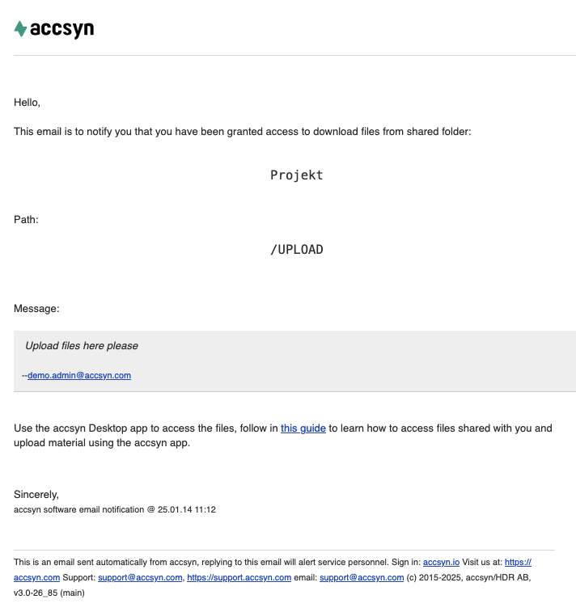
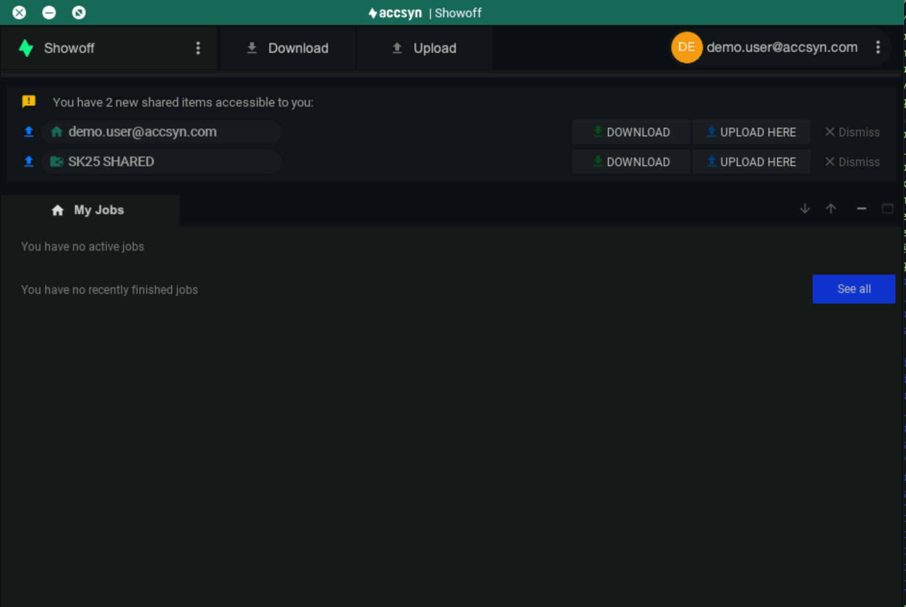
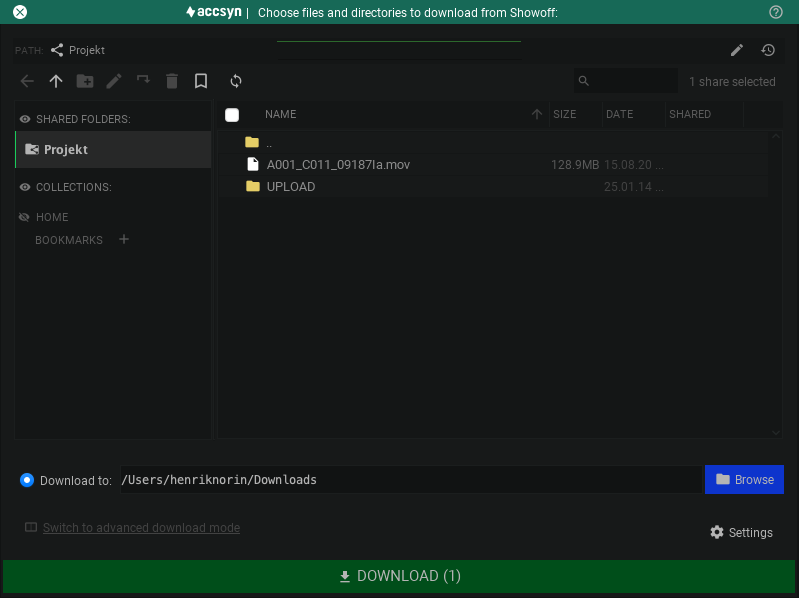
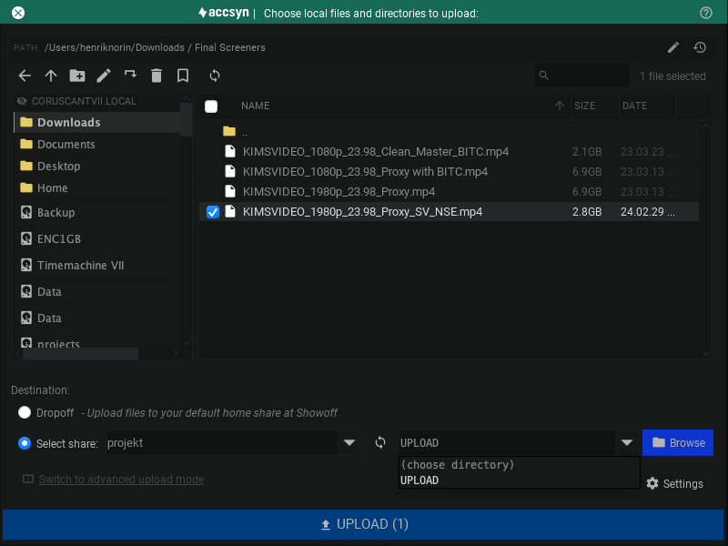
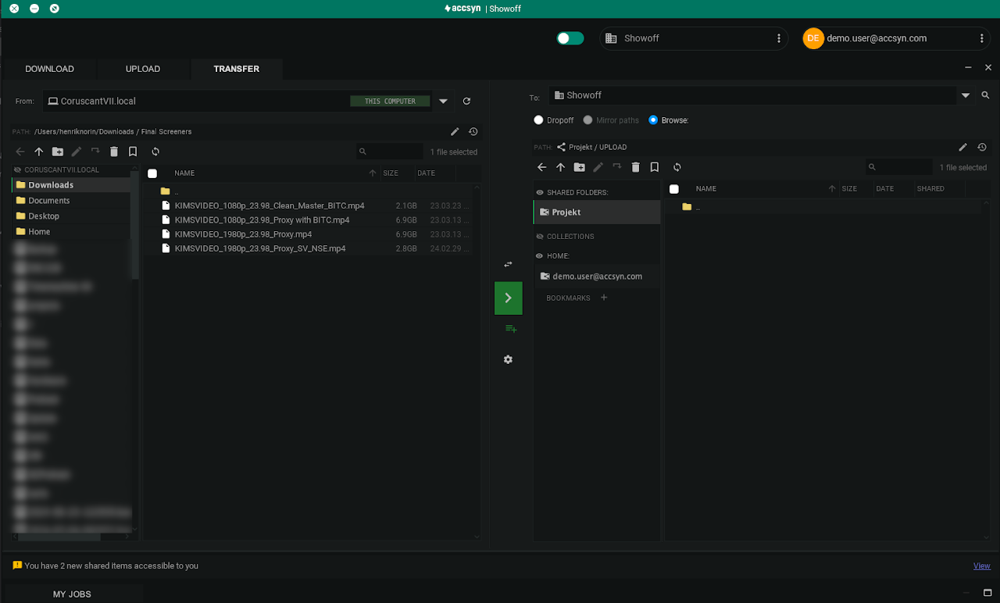

# Access shared folders

This guide is for end users who have been granted download and/or upload access to an accsyn shared folder or collection, and who are using the Desktop App for the first time.

You typically get access to a **specific project subfolder** on production storage — not the whole disk. Downloads and uploads run over the secure, accelerated [ASC](../whitepaper.md) protocol.

**Important:** If you received a **delivery**, use the link in the delivery email and follow [Receive a delivery](../delivery/receive.md). The Desktop App here is for **permanent** (or long-lived) shared folders and collections on accsyn storage.

## Email notification

When someone grants you access to a folder in an accsyn workspace, you should receive an email:

*Example of a file-sharing email notification.*

If this is your first time on the platform, you also receive an invitation explaining how to activate your accsyn account.

*Note: If you cannot find these emails, check spam. Search for sender [noreply@accsyn.com](mailto:noreply@accsyn.com).*

If you received no email, sign up at <https://accsyn.com/signup> with the same address the share was sent to. After sign-in you are taken to **Shared with me**, with instructions to continue.

## Installing the accsyn Desktop App

Follow [Install Desktop App](../desktop-app.md).

## Downloading files

1. Launch the Desktop App.
2. Sign in with the email address the share was sent to. You should see notifications for accessible items:

*Example: Desktop App with two newly accessible shared folders.*

3. Click the green **Download** button.

*Note: If you dismissed notifications, open **Download** in the top area to launch the download tool.*

4. Select which files and folders to download and the local destination:

*Example: accsyn download dialog.*

5. Click **Download** to start the transfer (ASC via the Desktop App).

Monitor progress in **My jobs** at the bottom of the app — ETR, and clues if the disk is full or permissions/network fail.

## Upload files

Launch the app, sign in, and click **Upload**:

*Example: upload tool.*

Choose the file(s) and/or folder(s), set **Destination** to the shared folder, then **Upload**.

## Advanced mode — Transfer

If you are used to FTP clients, use the **Transfer** view:

Source on the left, destination on the right. Click the green arrow in the middle to start the transfer.

## Manage app

### Installation location

Default locations for standard users (no admin rights):

- **Windows** — `C:\Users\<user account>\AppData\Local\Programs\Accsyn`
- **Mac** — chosen by user; recommended: `/Users/<user account>/Applications`
- **Linux** — chosen by user; recommended: `/home/<user account>/.local`

If installed as administrator / with elevated privileges:

- **Windows** — `C:\Program Files\Accsyn`
- **Mac** — recommended: `/Applications`
- **Linux** — recommended: `/usr/local/accsyn`

### Data files location

- **Windows** — `C:\Users\<user account>\AppData\Roaming\accsyn\data` (under `%APPDATA%`)
- **Mac** — `~/Library/Application Support/com.accsyn`
- **Linux** — `/home/<user account>/.accsyn/data`

Elevated installs:

- **Windows** — `C:\ProgramData\accsyn\data`
- **Mac** — `/Library/Application Support/com.accsyn`
- **Linux** — `/var/lib/accsyn`

Hint: back up and migrate this folder when moving machines to keep login and client credentials.

### Log files location

- **Windows** — `C:\Users\<user account>\AppData\Roaming\accsyn\log`
- **Mac** — `~/Library/Logs/accsyn`
- **Linux** — `/home/<user account>/.accsyn/log`

Elevated installs:

- **Windows** — `C:\ProgramData\accsyn\log`
- **Mac** — `/var/log/accsyn`
- **Linux** — `/var/log/accsyn`

Hint: ZIP this folder and attach it when opening a support ticket for stability issues.

### Uninstall app

As a standard user:

- **Windows** — run `C:\Users\<user account>\AppData\Local\Accsyn\uninstall.exe`
- **Mac** — move the `.app` bundle to Trash
- **Linux** — remove the application folder

Elevated installs:

- **Windows** — run `C:\Program Files\Accsyn\uninstall.exe`
- **Mac** — typically remove from `/Applications`
- **Linux** — typically remove from `/usr/local`

*Note: The uninstaller does not remove data and log files; delete those manually if needed.*

## Troubleshooting

**I am not allowed to install apps on my computer**

Shared folders require the Desktop App. Ask IT to whitelist it, or use another machine (for example a personal laptop), then move files via USB if needed.

**Download turns red and fails**

- Check free disk space on the destination drive.
- Whitelist the executable and allow outbound TCP from port **45190** upwards (ASC).
- Confirm the app can write to the download folder (or read files you are uploading).

**Can I download from several machines?**

Yes. Access lasts until revoked. You may install the app on as many machines as you need.

**Is the transfer encrypted?**

Yes. Accsyn uses AES encryption (AES-128 by default) and accelerates transfers with the proprietary [ASC](../whitepaper.md) protocol — suited to large folders and many files.

**The Desktop App freezes or crashes**

Email [support@accsyn.com](mailto:support@accsyn.com) with log files attached (see log locations above).

Further questions: chat or [support@accsyn.com](mailto:support@accsyn.com).

**Related articles:**

[File sharing](index.md) — share folders with employees and external users.

[Hosts](../admin/hosts.md) — automated deliveries and locally mapped shares.

[Python API](../developer/python-api.md) — automate shares and ACLs.
