# Home

Documentation and support for the accsyn file I/O platform — deliveries, file sharing, Media Vault, BYOS, and developer automation — underpinned by the accelerated [ASC](whitepaper.md) protocol.

New here? Start with the [Introduction](introduction.md) or a [free trial](trial.md).

## Status

-   ONLINE

-   **Ongoing incidents**

    ---

    \-

-   **Upcoming planned maintenance**

    ---

    \-

-   **Uptime**

    ---

    99.94% — 5 h outage in the recent year

-   **Guaranteed uptime**

    ---

    99.3% — max 61 h outage per year

-   **Recent outages**

    ---

    - 26.04.22 (10 min) — Auth0 DNS outage
    - 26.01.28 (5 min) — Cloud accsyn server outage
    - 25.08.13 (5 h) — Certificate upgrade issues

Identity provider status: [Auth0 status page](https://status.auth0.com/)

## Contact support

### Guidelines

Please follow these guidelines so we can help quickly:

- We are a small company. Support is answered by developers who know the codebase — usually the fastest route to a real fix.
- Check this knowledge base first; many common questions are already covered below.
- Use a descriptive subject. Prefer *Crash when writing file to disk* over *Need help*.
- Attach screenshots and log files when you can (locations below).
- We answer emails in order received. If production is blocked, start the subject with **URGENT** so we can prioritise.
- We respond during office hours (below). Outside those hours responses are best-effort.

### Office hours

Typical response within one (1) business day. Office hours:

08:00–18:00 CET ([Swedish holidays](https://www.officeholidays.com/countries/sweden))

### Chat support

The fastest channel is the live chat in the bottom-right corner of the site.

### Email support

[support@accsyn.com](mailto:support@accsyn.com)

### Premium Support and Enterprise

Enterprise customers and Premium Support subscribers get prioritised email, a private chat channel, and telephone support. We use Slack by default and invite you during onboarding.

*Note: If Slack is not an option, we can arrange another channel.*

For urgent matters when chat or phone does not respond in time, also email [support@accsyn.com](mailto:support@accsyn.com) with **URGENT** in the subject.

### Log file locations

**Server (daemon / service)**

- Windows: `C:\ProgramData\accsyn\log`
- macOS: `/var/log/accsyn`
- Linux: `/var/log/accsyn`

**Desktop App**

- Windows: `%APPDATA%\accsyn\log` (typically `AppData\Roaming\accsyn\log`)
- macOS: `~/Library/Logs/accsyn`
- Linux: `~/.accsyn/log`

`~` is your user home directory.

### Terms

accsyn SaaS is provided on a best-effort basis. See [Terms and conditions](https://accsyn.com/terms) and [Privacy policy](https://accsyn.com/policy).

### Login and website

- Workspace and account: <https://accsyn.io>
- Product site: <https://accsyn.com>

## Knowledge base

Guides for end users, operators, administrators, and developers.

### For end users

-   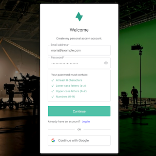

    **[Account](account.md)**

    ---

    Sign up and manage your personal accsyn account.

-   

    **[Download a delivery](delivery/receive.md)**

    ---

    Action an accsyn delivery or upload request.

-   

    **[Access shared material](file-sharing/access.md)**

    ---

    Access shared folders with the Desktop App (ASC transfers).

-   

    **[Automated deliveries & local shares](admin/hosts.md)**

    ---

    User server, automated deliveries, and locally mapped shares.

### Introduction and specifications

-   

    **[Introduction](introduction.md)**

    ---

    Platform overview for production (BYOS) and distribution (Cloud Vault).

-   

    **[Whitepaper](whitepaper.md)**

    ---

    ASC protocol, security architecture, and transfer lifecycle.

-   

    **[Specifications](specifications.md)**

    ---

    Technical feature and platform specifications.

-   

    **[Changelog](changelog.md)**

    ---

    What is new in recent releases.

### Operating

#### Deliveries

Send large folders over a link, or request uploads — ASC-accelerated with the Desktop App.

-   

    **[Introduction](delivery/index.md)**

    ---

    High-speed file delivery subsystem.

-   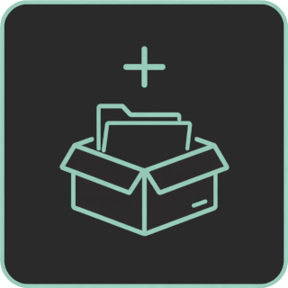

    **[Create delivery](delivery/create.md)**

    ---

    Create a delivery or upload request (including API).

-   

    **[Manage deliveries](delivery/manage.md)**

    ---

    Monitor and manage deliveries and upload requests.

#### File sharing

Share specific project subfolders on production storage with partners — ACL-controlled, ASC transfers.

-   

    **[Introduction](file-sharing/index.md)**

    ---

    File sharing as an FTP replacement on Cloud or BYOS.

-   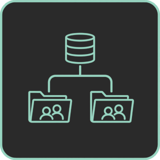

    **[Manage file sharing](file-sharing/manage.md)**

    ---

    Shares, ACLs, collections, homes, and API automation.

#### Media Vault

Tag and manage masters on accsyn Cloud — proxies, streaming, delivery, and lab workflows.

-   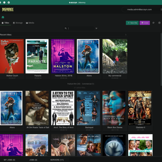

    **[Introduction](vault/index.md)**

    ---

    Media Vault overview (Cloud only).

-   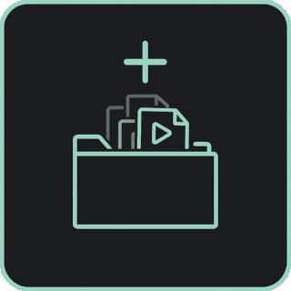

    **[Create title](vault/create.md)**

    ---

    Create your first title and folder layout.

-   

    **[Log title media](vault/log-media.md)**

    ---

    Upload and tag media into the Vault.

-   

    **[Work with media](vault/work.md)**

    ---

    Browse and manage titles and tagged media.

-   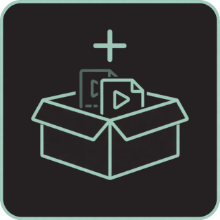

    **[Deliver title media](vault/deliver.md)**

    ---

    Deliver Vault media and request uploads to a title.

-   

    **[Transcode media](vault/process.md)**

    ---

    Proxies, VOD, and the Media Processor.

-   

    **[Stream title](vault/stream.md)**

    ---

    Browser streaming deliveries from a title.

-   

    **[Media Lab services](vault/media-lab.md)**

    ---

    Partner lab services for mastering, VOD, QC, and more.

#### General management

-   

    **[Job monitoring & queues](manage/job.md)**

    ---

    Inspect, prioritise, and manage transfer and compute jobs.

-   

    **[Transfer](manage/transfer.md)**

    ---

    Push/pull between HQ, sites, and users with mapped shares.

-   

    **[Troubleshooting](troubleshooting.md)**

    ---

    Find and resolve runtime issues.

### Administration

#### Trials and workspace admin

-   

    **[Users](admin/user.md)**

    ---

    Manage workspace users and roles.

-   

    **[Queues](admin/queue.md)**

    ---

    Configure workspace queues and priorities.

-   

    **[Clients](admin/client.md)**

    ---

    Audit registered file-transfer clients.

-   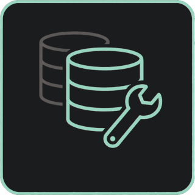

    **[Storage](admin/storage.md)**

    ---

    Configure volumes and shared folders.

-   

    **[Workspace settings](admin/settings.md)**

    ---

    Global workspace settings.

-   

    **[Start a free trial](trial.md)**

    ---

    Try accsyn with your organisation.
    

#### BYOS — Bring Your Own Storage

Run servers on your office or cloud premises for production I/O.

-   

    **[Set up BYOS](admin/byos/index.md)**

    ---

    Install and licence BYOS workspaces.

-   

    **[Servers](admin/byos/server.md)**

    ---

    Install and manage storage and site servers.

-   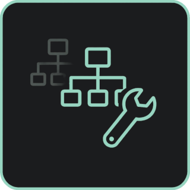

    **[Sites](admin/byos/site.md)**

    ---

    Remote offices and cloud sites.

-   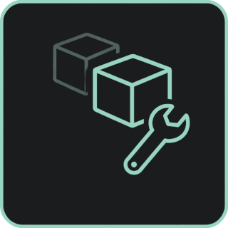

    **[Engines](admin/byos/engine.md)**

    ---

    Engines for render/compute farms.

### For developers

Automate transfers, hooks, publish workflows, and multi-site farms.

-   **[Developer Hub](developer/index.md)**

    ---

    Automate file transfers and compute in your pipeline.

-   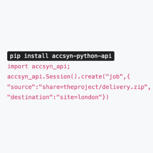

    **[Python API](developer/python-api.md)**

    ---

    API keys, install, and getting started with Python.

-   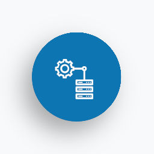

    **[Hooks (BYOS)](developer/hooks.md)**

    ---

    Run scripts on transfer and job events.

-   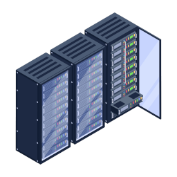

    **[Render farm (BYOS)](developer/farm.md)**

    ---

    Deploy compute across one or more sites.

-   

    **[Publish (BYOS)](developer/publish.md)**

    ---

    Validate and ingest vendor submissions.

-   **[Job JSON specification](developer/job-specification.md)**

    ---

    Job create payload syntax and examples.

## Codes and settings

-   **[Warning codes](warnings.md)**

    ---

    Warning codes shown in the product.

-   **[Error codes](errors.md)**

    ---

    Error codes shown in the product.

-   **[Internal settings](settings.md)**

    ---

    Internal entity and workspace settings reference.

## Tutorials

-   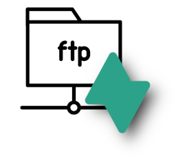

    **[FTP server replacement](tutorials/ftp-server-replacement.md)**

    ---

    Replace FTP with ACL sharing and ASC performance.

-   

    **[Outsourcing pipeline](tutorials/outsourcing-pipeline.md)**

    ---

    Unattended vendor send and publish ingest.

-   

    **[Remote office sync](tutorials/remote-office-sync.md)**

    ---

    Automate sync between offices and cloud with the Python API.

-   

    **[Film festival](tutorials/film-festival.md)**

    ---

    Festival file management with deliveries and Vault.

## Terminology

- **accsyn Cloud backend** — Cloud software that schedules transfer jobs and hosts media. Each customer has an isolated backend instance and database.
- **accsyn daemon** — Background Java service on a file server or machine with disk access (also a “server” endpoint). Used for BYOS, sites, and User servers.
- **accsyn Desktop App** — Java desktop app (Windows, macOS, Linux) for users to upload and download (a “client” endpoint).
- **ASC** — Accsyn Copy Protocol — proprietary accelerated, encrypted file transfer protocol.
- **ACL** — Access Control List — which users may access which paths on a share.
- **Cloud storage** — Default volume on standard Cloud workspaces.
- **Delivery** — Package of files/folders for one or more recipients (ASC or HTTPS).
- **Download / upload** — Transfer from workspace server to client, or client to server.
- **Dropoff** — Upload without browsing a destination (default shared folder / date folder).
- **Hook** — Script or app run when a job reaches a given state.
- **Host** — Running app or daemon process on a computer (browser sessions excluded).
- **HQ** — Main site (default code `hq`) where central storage is served.
- **Job** — Transfer or compute package of one or more tasks; may carry JSON metadata.
- **Media** — File or folder on Cloud storage tagged in the Vault (proxies and metadata).
- **Path** — Absolute filesystem path, or accsyn path such as `volume=storage/…` or `share=myshare/…`.
- **Push / pull** — HQ→site or site→HQ mirrored sync.
- **Queue** — Ordered job container with priority (default Medium @ 500; also Low @ 1, High @ 999).
- **Roaming site** — Built-in site for standard (and unassigned elevated) clients.
- **Server** — Client role that serves a volume; main server serves the default volume and may run hooks. Needs TCP ports (default 45190–45210) reachable as required.
- **Shared folder** — Subfolder of a volume shared via ACLs.
- **Site** — Remote office or cloud location; may have its own site server.
- **Stream** — Delivery variant with browser-playable media.
- **Transfer** — Job moving data between two endpoints (not always via HQ).
- **Upload request** — Reverse delivery asking users to upload to a temp or fixed path.
- **User** — Account identified by email; roles admin, employee, or standard.
- **Volume** — Root disk/share exposed to accsyn (code + OS paths); one default volume for temp uploads and homes.
- **Workspace** — Customer organisation / domain with an accsyn licence.
