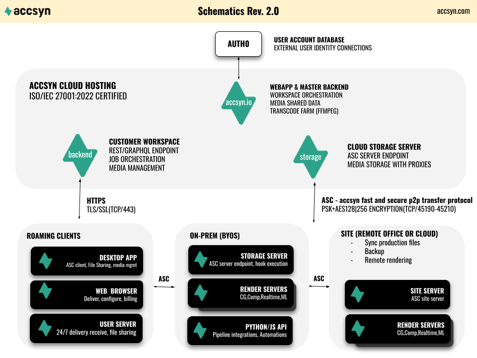

# An introduction to accsyn

accsyn is a complete **file I/O platform** for film and media — deliveries, collaboration, sites, automation, and master archival — underpinned by the high-speed encrypted **[ASC](whitepaper.md)** (accsyn Copy) protocol.

Use it to move **large folders and many files** between locations securely and efficiently, whether you keep storage on your own infrastructure or manage masters in the cloud.

## Who is accsyn for?

Two primary paths, one platform:

### Media production — expose your own storage (BYOS)

Post houses, VFX, DITs, and studios that need accelerated, secure file I/O on **production storage they already own** — on-premises or in their cloud VPC.

- Deliver and receive multi-terabyte packages over a link ([Delivery](delivery/index.md))
- Share **specific project subfolders** with vendors and partners via ACLs ([File sharing](file-sharing/index.md))
- Sync remote offices and cloud sites ([Sites](admin/byos/site.md))
- Push/pull with remote users via mapped shares and User servers ([Hosts](admin/hosts.md))
- Automate with [hooks](developer/hooks.md), [publish](developer/publish.md), [Python API](developer/python-api.md), and [render/compute](developer/farm.md)

Start with [BYOS](admin/byos/index.md) and a [free trial](trial.md).

### Media distribution — master archive in the cloud

Distributors, festivals, sales agents, and archives that need a **secure cloud location** for masters and deliverables, with built-in streaming, delivery, collaboration, and lab handoff.

- Tag and organise masters in the [Media Vault](vault/index.md) (IMDb linkage, proxies, QC-oriented workflows)
- Stream and deliver to cinemas, buyers, and partners ([Stream](vault/stream.md), [Delivery](delivery/index.md))
- Collaborate on sales and festival packages ([File sharing](file-sharing/index.md))
- Optional [Lab services](vault/media-lab.md) for mastering, VOD export, QC, and more

Cloud Vault runs on accsyn Cloud storage only (not BYOS). To combine on-prem production storage with Vault archival, use two workspaces — see the note under [Media Vault](vault/index.md).

## Why accsyn?

Slow transfers and fragmented tools still dominate media pipelines. Accsyn is built as the **file hub from set to screen** — cinema or streaming — with ASC for accelerated peer-to-peer transfers, central orchestration, and audit.

Security highlights: HTTPS for control-plane traffic; AES-encrypted ASC for data; on-demand listeners (no ASC port open 24/7). Full detail: [Whitepaper](whitepaper.md).

## How does it work?

The accsyn cloud backend orchestrates high-speed P2P transfers, compute jobs, and media management. The Desktop App (and background daemon/User server) acts as the transfer endpoint on each machine.

## Free trial

Start a **30-day trial** (500 GB Cloud or one BYOS storage server) at <https://accsyn.io/trial> — full features, no credit card.

1. Register at <https://accsyn.io> and verify your email.
2. Click **Start 30 days free trial** and create your workspace.
3. Send a [delivery](delivery/index.md), [share a folder](file-sharing/index.md), or explore [BYOS](admin/byos/index.md) / [Media Vault](vault/index.md).

Step-by-step: [Trial](trial.md).

## Licensing and pricing

An accsyn licence includes unlimited traffic, bandwidth, and standard users (delivery recipients and file-sharing users). Operator seats and storage (Cloud) or servers (BYOS) are licensed separately.

| | **accsyn Cloud** | **Cloud Essentials** | **accsyn BYOS** | **BYOS Lite** |
| --- | --- | --- | --- | --- |
| Storage | 1 TB + PAYG | 500 GB | Unlimited (your disk) | Unlimited (your disk) |
| Operators | 2 + PAYG | 1 | 2 + PAYG | 2 + PAYG |
| Users | Unlimited | Unlimited | Unlimited | Unlimited |
| Traffic / bandwidth | Unlimited | Unlimited | Unlimited | Unlimited |
| Storage servers | 1 (Cloud) | 1 (Cloud) | 1 included | 1 included |
| Site / render servers | N/A | N/A | PAYG | PAYG |
| Media Vault / streaming / deliverable transcode | :material-check:{ .feature-yes } | :material-check:{ .feature-yes } | N/A | N/A |
| Hooks / publish / render | N/A | N/A | :material-check:{ .feature-yes } | :material-check:{ .feature-yes } |
| API | :material-check:{ .feature-yes } | N/A | :material-check:{ .feature-yes } | N/A |
| Lab services | :material-check:{ .feature-yes } | :material-check:{ .feature-yes } | N/A | N/A |
| Professional services | :material-check:{ .feature-yes } | :material-check:{ .feature-yes } | :material-check:{ .feature-yes } | :material-check:{ .feature-yes } |

Usage is measured at midnight CET; peak usage bills into the next cycle. Price list: [Pricing](https://accsyn.com/pricing).

**Essentials / Lite** are budget variants: Essentials is 500 GB Cloud with one operator and no API; Lite is one BYOS storage server with two operators and no API.

## Lab and professional services

**[Media Lab](vault/media-lab.md)** — Partner lab work (mastering, VOD export, QC, grading, and more), charged per order item, hours, and deliverable. Place orders from the Desktop App on Cloud workspaces.

**Professional services** — With **25+ years of media IT experience**, billed hourly for:

- Deploying and configuring accsyn (cloud, BYOS, or hybrid)
- Integration and pipeline design (deliveries, sharing, sites, hooks, compute)
- Media IT advice (storage, networking, security, operations)
- Education and onboarding

## Where to go next

| Goal | Start here |
| --- | --- |
| Send / receive large packages over a link | [Delivery](delivery/index.md) |
| Share project subfolders with partners | [File sharing](file-sharing/index.md) |
| Host and tag masters in the cloud | [Media Vault](vault/index.md) |
| Run on your own storage | [BYOS](admin/byos/index.md) |
| Automate transfers and farms | [Developer Hub](developer/index.md) |
| Protocol and security deep dive | [Whitepaper](whitepaper.md) |
| Desktop App install | [Desktop App](desktop-app.md) |
| Specs and platforms | [Specifications](specifications.md) |

## What does “accsyn” mean?

**acc**elerated file **syn**chronisation.

More at <https://accsyn.com>.
