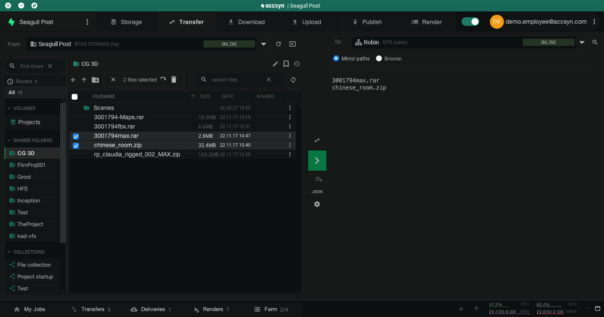

# Transfer

This guide is for operators (admin or employee) who need to move files between endpoints with the Desktop App **Transfer** tool — over the secure, accelerated [ASC](../whitepaper.md) protocol.

Typical operations:

- **Download from / upload to a site** — Sync material between main (HQ) storage and a remote office or cloud site.
- **Push to / pull from a remote user** — Exchange files with a user who has one or more shares [mapped locally](../admin/hosts.md#map-shares-locally) (Desktop App or User server).

You can use either the **workspace endpoint** (main site / HQ storage) or a **remote site** as source or destination. Transfers are peer-to-peer between the selected endpoints; they do not have to pass through HQ when both sides are sites or a site and a mapped user.

*Note: Creating transfers in the Transfer tool is currently available in the **Desktop App** only. Web-based transfer creation may be added in a future version. You can still [monitor and manage](job.md) running jobs on the web.*

## Prerequisites

- Signed in to the [Desktop App](../desktop-app.md) as an administrator or employee.
- For **site** transfers: sites and site servers configured — see [Site administration](../admin/byos/site.md).
- For **remote user** push/pull: the user has mapped the relevant share(s) locally, ideally with a [User server](../admin/hosts.md) for unattended 24/7 access. Read access on the mapping allows operators to **pull** (upload from the user); write access allows **push** (download to the user).

## Create a transfer

Open **Transfer** in the Desktop App top menu. You get a dual-pane browser: source on the left, destination on the right.

*Example: transferring selected files from HQ storage to a remote site with mirror paths enabled.*

1. **Select the source endpoint** on the left (main storage / HQ, a site, or a user with mapped shares), then select the file(s) and/or folder(s) to send.
2. **Select the destination** on the right (main storage / HQ, a site, or a mapped user).
3. If the destination has a matching share context (volume served on that site, or a share the user mapped locally), **Mirror paths** is available and selected by default — the relative folder structure is preserved. Otherwise use **Browse** to choose a destination folder.
4. Click the green **>** button in the middle to start the transfer.

Progress appears under **My Jobs** / **Transfers** in the bottom panel. Pause, resume, abort, and re-queue from there or from [Job & queue management](job.md).

## Related articles

- [Site administration](../admin/byos/site.md) — Add sites and site servers for office/cloud sync.
- [Hosts](../admin/hosts.md) — Install a User server and map shares for remote push/pull.
- [Job & queue management](job.md) — Monitor and prioritise transfer jobs.
- [File sharing](../file-sharing/index.md) — Shares, ACLs, and local mapping concepts.
- [Remote office sync](../tutorials/remote-office-sync.md) — API-driven site synchronisation tutorial.
