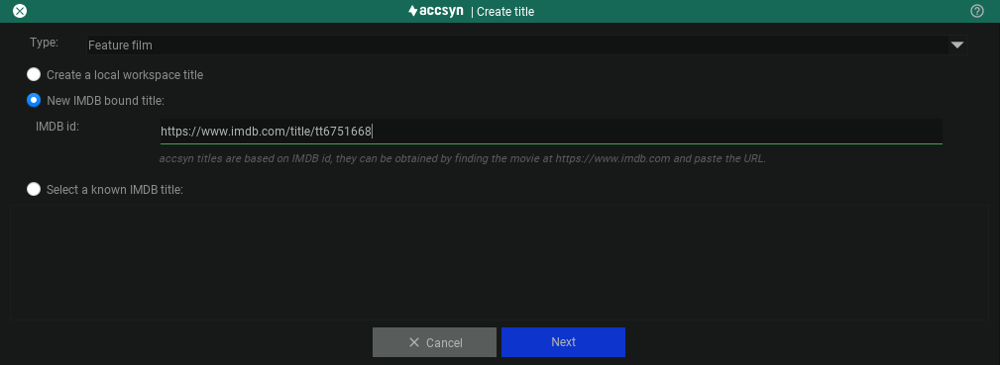
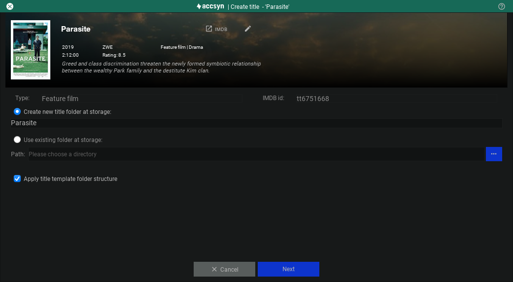
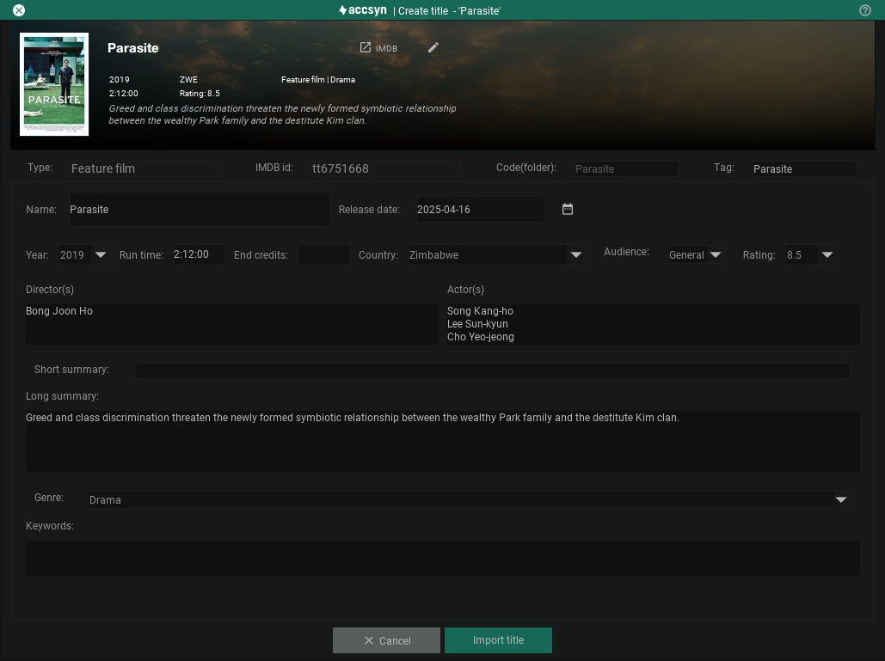

# Create a title

Create your first accsyn title (project) and prepare it for tagged deliverable media on Cloud storage. Large uploads use the Desktop App and the secure, accelerated [ASC](../whitepaper.md) protocol.

### Preparations

- [Install the accsyn Desktop App](../desktop-app.md).
- Launch the app.
- Sign in as an administrator or employee.

*Note: Media Vault is not available on BYOS workspaces — use an accsyn Cloud workspace.*

## Create title

1. Open the **VAULT** tab. On a new workspace it may be empty.
2. Click the empty **New title or project** card, or **NEW TITLE** in the toolbar:

### Type

Choose how the title is identified — this controls whether it can be bound to IMDb:

- **Create a local workspace title** — Not bound to IMDb; for corporate or other generic media projects.
- **New IMDb-bound title** — Enter an IMDb URL or ID (for example `tt6751668`). Accsyn fetches metadata via OMDB when available. If the title is missing from OMDB, create it as a local workspace title instead.
- **Select an existing accsyn title** — Browse titles already added elsewhere on the platform and reuse them.

If the title already exists in accsyn, prefer **Select an existing accsyn title**.

3. Click **Next**. The cover image is downloaded when available; change it with the pencil on the cover. Optionally set a banner (JPEG, ideally 9:1) via the pencil in the upper-right.

4. Choose the folder for the title. Accsyn suggests a name matching the title; you can also pick an existing folder. Enable **Apply title template folder structure** to create standard category folders (see below).

5. Click **Next** to open the title editor. Fill in attributes now or later. Many fields are required for exporters to work correctly.

*Example: title creation in accsyn.*

6. Click **Create title** / **Import title** to create the title in your workspace and deploy the folder structure. Titles new to the platform are also registered centrally.

Missing an attribute you need? Contact us and we can add it.

### Title template folders

When you apply the template, accsyn creates a standard layout for organising deliverables, for example:

- **DCP** — DCP masters
- **MAS** — Feature-length masters
- **VOD** — VOD deliverables (transcoded or uploaded)
- **SUB** — Subtitles associated with masters by type, content, and category tags
- **SND** — Sound mixes
- **PIC** — Pictures and extracted stills
- **VID** — Other video material
- **SALES** — Marketing material related to the title
- **TRL** — Trailer masters
- **INGEST** — Staging area for media before tagging; use any substructure that suits you

If you skip the template, folders are created later when you upload in the Media view, based on type, content, and category tags.

You are ready to [upload and tag your first media](log-media.md).

## Related articles

[Media Vault introduction](index.md)
