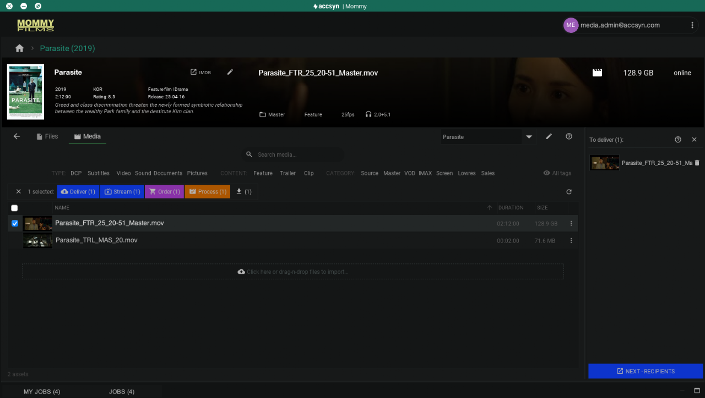

# Deliver title media

Deliver tagged media and folders from the Media Vault using the Desktop App. Transfers to recipients use the secure, accelerated [ASC](../whitepaper.md) protocol when they download with the app. For general (non-Vault) deliveries, see [Create a delivery](../delivery/create.md).

## Deliver media

1. Sign in to the Desktop App on a Cloud (non-BYOS) workspace and open the title.
2. Select the media to deliver, then click **Deliver**, or right-click → **Deliver**:

Items appear in the cart on the right. Remove entries with the trash can.

From the title **Files** view you can also right-click a file or folder → **Deliver**.

3. When the package is ready, click **NEXT — RECIPIENTS**.

A browser window opens on the standard delivery page so you can add recipients, expiry, and access options. Details: [Create a delivery](../delivery/create.md). Recipients can follow [Receive a delivery](../delivery/receive.md).

### Monitor deliveries

Prefer <https://accsyn.io/outbound> in the browser for full status and editing. The Desktop App **JOBS** tab (bottom area) gives a shorter overview.

Next: [Process media](process.md) — transcode masters for VOD, streaming, and related formats.
