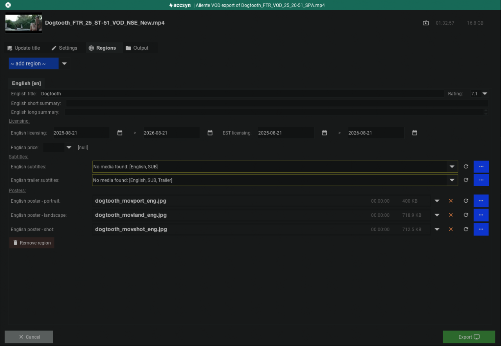

# Export

Package tagged video with subtitles and related assets into packages that VOD platforms can ingest.

Currently supported natively:

- **Allente**

For other popular platforms, see [Media Lab](media-lab.md).

## Allente

1. Transcode VOD media from a high-resolution master with the [Processor](process.md). Recommended: HD ~25 Mbit H.264 with ~256 kbit stereo.
2. For each region (language), log landscape, portrait, and shot poster images; log subtitles for that language; optionally a trailer with subtitles.
3. Select the VOD media and open the processor.
4. Open the **VOD export** tab and choose the Allente exporter:

The exporter shows a media preview and four tabs:

### Update title

Add title metadata that was missing at creation but is required for export.

### Settings

- **Customer** — N/A
- **Type** — SVOD, TVOD, or EST
- **Trailer** — Trailer to include

### Regions

Per language / region:

- Title, short summary, long summary in that language
- **Licensing** — Date range the platform may stream
- Price for viewing / renting
- **Subtitles** — Main (and optional trailer) subtitles
- **Posters** — Region-language posters
- **Remove region**

### Output

- **Deliver (temp)** — Deliver to recipients from a temporary folder deleted when the delivery expires
- **Deliver (custom)** — Store permanently on storage, then deliver from there
- **Custom** — Store on storage only

Click **Export** to run on the farm. Missing required fields are reported.

*Note: Not every field is required for Allente (for example a trailer may be optional).*

### Monitoring export

Watch the **JOBS** tab at the bottom of the app. Contact support if something looks wrong.

Back to [processor](process.md).
