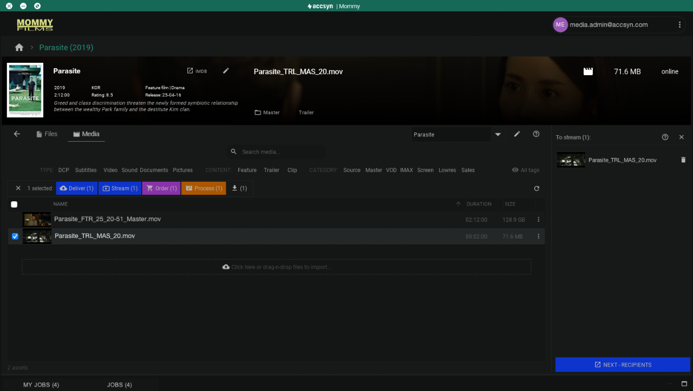
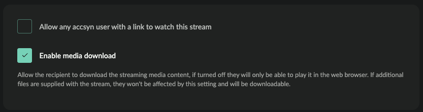
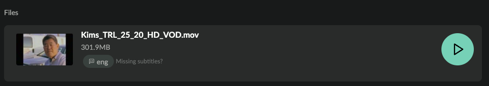

# Stream title media

Send VOD web streams so recipients can play tagged Vault media in a browser. Optional file downloads still use link-based delivery and [ASC](../whitepaper.md) when recipients use the Desktop App.

*Note: Web streaming includes an initial allowance of free views; further views are billed in arrears. See [pricing](https://accsyn.com/pricing).*

## Prepare streaming

1. A title has been [created](create.md).
2. Video media is [logged](log-media.md) with **Type** = VID.
3. For subtitles: matching **Content** on video and subtitle assets, and a **Subtitles** language tag on the subtitle media.

## Create stream

1. Sign in to the Desktop App on a Cloud (non-BYOS) workspace as an employee or administrator.
2. Open the title. Filter by **VOD** category and select the VOD media to stream — or use the Video type filter to stream other video.
3. Click **Stream**, or right-click → **Stream**.
4. Media appears in the streaming cart on the right:

*Streamable media in the cart, ready to submit.*

5. Add more media or ordinary files (recipients can download those while watching).
6. Remove items with the trash can.
7. Click **NEXT — RECIPIENTS**. If no HD HLS streaming proxy exists yet, transcoding starts on the farm; recipients may see a placeholder until it finishes.

A browser window opens on the standard delivery page for recipients, expiry, and access options.

### Restricting download access

By default, VOD download is disabled — recipients can watch but not download. Enable **Enable media download** if they should also download:

## Subtitles

Accsyn finds subtitle media that share the video’s **Content** tag and have **Subtitles** set to the language.

Example:

- Log `Festival_feature_4444_stream.mov` with **Content** = FTR (Feature).
- Log `Festival_feature_4444_stream_swe.srt` with **Content** = FTR and **Subtitles** = swe.
- Repeat for other languages.

In the browser player, available subtitles appear on each playable file. Example with English subtitles:

More on deliveries: [Create a delivery](../delivery/create.md). Recipients: [Receive a delivery](../delivery/receive.md).
