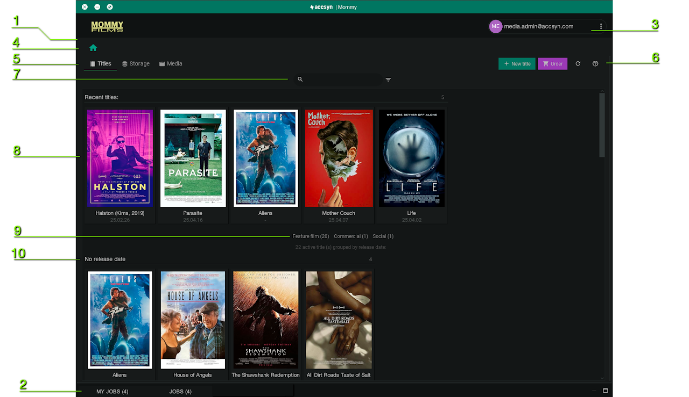
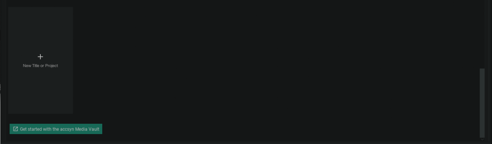
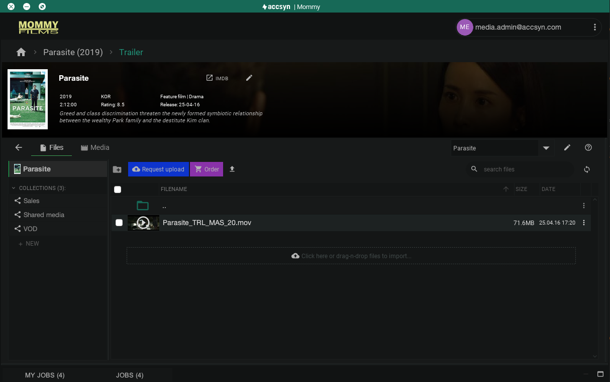
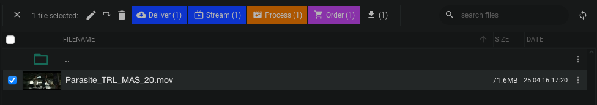
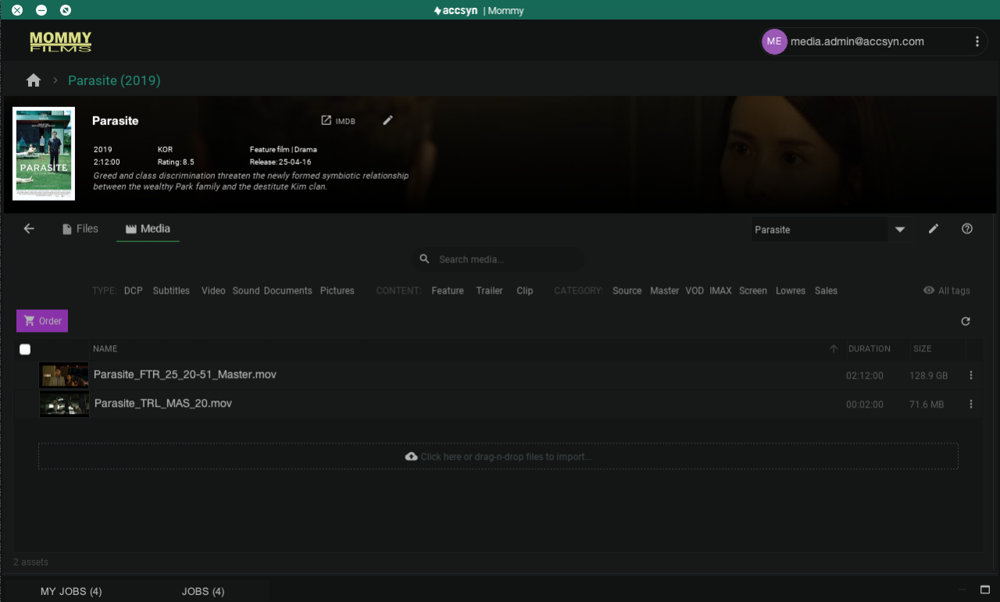

# Work with titles and media

This guide describes the Vault view in the Desktop App — how to navigate, find titles and tagged media, and manage your library on Cloud storage. Uploads and downloads of large packages use [ASC](../whitepaper.md) through the app.

*Note: The Vault view is not available on BYOS workspaces.*

## A breakdown of the Vault

After sign-in you land in the Vault, with titles in a grid:

*Breakdown of the Media Vault UI.*

### 1 — Vault view

Main title/media area. If the monitor panel is maximised, restore the Vault with the **VAULT** button at the top.

### 2 — Monitor panel

Bottom jobs panel — file transfers and proxy/transcode queue.

### 3 — Account button

Shows the signed-in user (email). Opens settings, switch user, check for updates, and quit.

### 4 — Breadcrumb

Top left: home and path within the Vault (usually starting at the selected title).

### 5 — Main navigation

- **Titles** — Browse and search titles and projects.
- **Storage** — Browse accsyn Cloud storage.
- **Media** — Browse and search all Vault media.

## Title browser

### 6 — Titles toolbar

- **NEW TITLE** — Create a title/project; see [Create title](create.md).
- **Order** — Place a Media Lab order; see [Media Lab](media-lab.md).
- Reload titles.
- Help — opens this documentation.

### 7 — Search and filter / display

Enter text and press Enter to search by title name.

The filter button (right of search) lets you:

- Filter by title type
- Group titles by an attribute
- Set cover image size

### 8 — Recent titles

The five most recently viewed titles.

### 9 — Type filter buttons

Filter the listing by type.

### 10 — Title listing

Titles matching type, search, and grouping. Click a title to open it; use **+** to [create a title](create.md).

Edit a title by clicking its name when the pen icon appears on hover.

### New title placeholder

At the bottom of the listing, click the placeholder to create a title/project:

## Title view — files

Default title view: banner plus file browser.

*Example: title Files view.*

### Title banner

Shows title and media summary.

- **IMDb** — open the title on IMDb.
- Pencil — [edit or remove the title](#manage-title).

*Note: A default banner background is shown until you set a custom banner in Edit title.*

### Toolbar

- **Back** — Clear selection and return to the titles view.
- **Files** — File browser mode.
- **Media** — Media browser mode (see below).
- **Title selector** — Switch title.
- **Edit title** — [Edit or remove](#manage-title).
- **Help** — This guide in the browser.

The file browser has a share browser on the left and a file list on the right.

### Share browser

Browse the title (default), or a shared folder / collection beneath it. See [Storage](#storage) for ACL sharing.

### File list

Files in the current title folder.

**Toolbar** (nothing selected):

- Create folder
- **Request upload** — send an upload link to this folder
- **Order** — Media Lab order for this title; see [Media Lab](media-lab.md)
- **Upload** — upload and ingest media
- Search files
- Reload (the view also refreshes about every 10 seconds)

**Folder contents**

- Ordinary files: name, size, modification date
- Media: thumbnail — click to open image or play video proxy
- Double-click a folder to enter it
- Sort via column headers
- Right-click empty space for the same actions as the toolbar

**File and media actions** (when items are selected):

- **×** — Clear selection
- Rename / Move / Delete (media can also be un-ingested from Media view without deleting the file)
- **Deliver** — see [Deliver media](deliver.md)
- **Stream** — see [Stream media](stream.md)
- **Process** — see [Media processor](process.md)
- **Order** — see [Media Lab](media-lab.md)
- **Download** — download to your computer (ASC via Desktop App)

## Title view — media

All media ingested under the title:

### Search media

Enter text and press Enter to search filename and tags within the title.

### Tag selectors

Filter by type, content, and category — find deliverables without walking the folder tree.

**All tags** switches to advanced mode across technical tags on the platform.

### Advanced media tag filters

Shown by default for administrators (hidden for employees). Detailed filters from the Vault tagging model:

- Use each menu to pick a tag value
- **Clear selection** resets filters
- Refresh reloads tags from the central registry
- **−** hides the advanced panel

### Toolbar and action bar

Same behaviour as in Files mode.

## Manage title

Click the pencil next to the title selector, or the pencil in the banner.

Attributes save when a field loses focus.

### Custom cover image

Click the pencil on the cover and choose a local JPG or PNG (ideal about 175×240). Restore the IMDb cover with the undo icon.

### Custom banner image

Click the pencil in the upper-right of the banner and choose a JPG or PNG (ideal about 1800×200 / 9:1). Clear with the remove control next to the edit icon.

### Remove a title

Remove all media beneath the title first (select media → right-click → **Remove**), then remove the title.

## Manage media

Rename, move, and delete physical files from the title **Files** view (or main Cloud **Storage**).

### Media info

Right-click → **Info** for the metadata panel.

### Edit media tags

Right-click → **Edit tags**. Change values except type and extension (type follows the file extension).

### Rename media

Right-click → **Rename**.

### Remove media

Right-click → **Remove media** to un-ingest. Choose how physical files on storage are handled afterward.

## Storage

Browse and manage the whole Cloud volume — folders outside titles for deliveries, file sharing, backup, and so on. Same layout as title Files, with ACL info on the right and folder sharing.

## Media (global)

Browse all tagged media across titles — advanced search and library-wide monitoring.

Next: [Process / export](process.md) media from the Vault.

**Related articles:**

[Lab services](media-lab.md) — help with ingest, deliverables, QC, transcoding, and SVOD/TVOD export.
